<p align="center"></p>

# The kidney cancer proteome: a proteomics analysis in the LSMA Analysis Lab

**Do the changes seen in the RNA of clear cell renal cell carcinoma reach the proteins that do the work in the cell?**

This repository is a worked example from the **LSMA Analysis Lab**, the analysis platform of the [London School of Multiomics & AI](https://lsma.co.uk). The full analysis was run in the lab, without writing code: import of public data, quality control, normalisation, exploration, differential abundance and pathway enrichment. The report, figures and tables it produced are here, with a validation against RNA from independent patients.

| | |
|---|---|
| **Data** | CPTAC ccRCC Discovery study (Clinical Proteomic Tumor Analysis Consortium, PDC000127), TMT-labelled global proteome |
| **Samples** | 154: tumour and normal kidney from the same 77 patients (6 non-clear-cell tumours excluded) |
| **Comparison** | tumour vs adjacent normal kidney, paired by patient |
| **Lab module** | Proteomics (workflow version 1.0.0) |
| **Lab run time** | **2 min 40 s** for the whole analysis (plus 15 s to import 160 samples from the Proteomic Data Commons) |
| **Validation** | RNA fold changes from two independent kidney cancer cohorts (TCGA-KIRC and GSE102101, from the [bulk RNA-seq analysis](https://github.com/MultiOmics-Intelligence/lsma-lab-bulk-rnaseq-kidney-cancer-tcga-kirc)), and the published CPTAC findings |
| **Result** | **Replicated**: 93–94% of the changed proteins move in the same direction as their RNA in other patients |

---

## Biological question and aim

**Question.** The companion repositories show what clear cell kidney cancer does to its RNA, its DNA methylation, its enhancers and its DNA. But most of the work in a cell is done by proteins, and RNA levels do not always predict protein levels. Which proteins really change in the tumour?

**Hypothesis.**
- If loss of *VHL* switches on the hypoxia programme, hypoxia proteins such as **CA9** should be higher in the tumour.
- The tumour should show the **Warburg switch** at protein level: more glycolysis enzymes and less of the mitochondrial respiratory chain (oxidative phosphorylation).
- Most protein changes should match the RNA changes seen in other patients with the same cancer.

**Aims**
1. Check the quality of 160 proteomes and keep only clear cell tumours with their matched normal kidney.
2. Find the proteins that are higher or lower in the tumour, accounting for the patient.
3. Find the pathways those proteins belong to.
4. Test whether the protein changes agree with RNA changes in two independent cohorts.
5. Show each step as it is run in the LSMA Analysis Lab, so a student can repeat it.

---

## Background: clear cell kidney cancer at protein level

**Clear cell renal cell carcinoma (ccRCC)** is the most common kidney cancer. In most tumours the *VHL* gene is lost (see the [mutation analysis](https://github.com/MultiOmics-Intelligence/lsma-lab-somatic-mutations-kidney-cancer-tcga-kirc)). Without VHL, the cell behaves as if it were short of oxygen, even when it is not:
- **Hypoxia genes are switched on**, such as *CA9* and *VEGFA*, which feeds the tumour's rich blood supply.
- **Metabolism changes.** The cells burn glucose by glycolysis and turn down the mitochondria, and they fill with fat and glycogen, which gives them their "clear" look under the microscope.

**Proteomics** measures the proteins themselves. Here the samples were measured by mass spectrometry with **TMT labels** (tandem mass tags): ten samples are mixed and measured together, and each protein's amount is reported as a log ratio to a pooled reference sample that is run in every batch.

The CPTAC consortium published this cohort in *Cell* in 2019 (Clark et al.). It reported a strong drop in oxidative phosphorylation proteins and a rise in glycolysis and immune proteins in the tumours.

---

## Key findings

1. **The tumour proteome is very different from normal kidney.** 860 proteins change at adjusted p < 0.05 and at least two-fold: **230 higher** and **630 lower** in the tumour (Figure 1).
2. **The hypoxia programme is visible at protein level.**
   - **CA9**, the classic marker of VHL loss, is 5-fold higher (log2 fold change +2.36).
   - **NDUFA4L2**, a hypoxia-induced protein that dampens the respiratory chain, is the most increased of all (log2 fold change +3.66, about 13-fold).
   - Also higher: **ANGPTL4** (+1.74) and **VEGFA** (+1.33).
3. **The Warburg switch** (Figure V1, right).
   - **Glycolysis enzymes are higher:** PFKP (+1.90), HK2 (+1.56), PKM (+1.25), LDHA (+1.18), with ENO1, PGK1, ALDOA, GAPDH and TPI1 all up.
   - **Respiratory complex I proteins are lower:** NDUFS4 (−2.33), NDUFA4 (−2.09), NDUFA10 and others.
4. **Pathways** (Figure 4, hallmark gene sets).
   - **Lower in the tumour:** oxidative phosphorylation (NES −3.29, the strongest signal of all), fatty acid metabolism (−2.36) and adipogenesis (−2.25).
   - **Higher in the tumour:** interferon-γ response (+3.05), allograft rejection (+2.84), cell cycle E2F targets (+2.43), hypoxia (+2.28) and glycolysis (+1.76).
   - The immune signals fit the high T-cell infiltration of ccRCC seen in the [single-cell analysis](https://github.com/MultiOmics-Intelligence/lsma-lab-single-cell-kidney-cancer-ccrcc).

Evidence labels from the lab: the differential abundance is *statistically supported*; pathway readings are *biological interpretation*.

---

## Quality control and PCA

| Check | Result |
|---|---|
| Samples imported | 160 from the PDC; 6 non-clear-cell tumours excluded in the lab's sample preparation (reasons recorded) |
| Samples analysed | 154: 77 tumours and their 77 matched normal samples |
| Proteins | 9,591 quantified; **8,801 kept** after requiring a value in at least 66% of the samples of one group |
| Proteins per sample | about 8,700 to 9,000; no sample flagged as an outlier (Figure QC1) |
| Missing values | 2% of the kept values, filled in at a low level (MinProb), as missing proteomics values usually mean low abundance (Figure QC4) |
| Normalisation | median centring, so every sample has the same median (Figure QC6) |

**Reading the sample correlation heatmap (Figure QC5).** In most omics data, all samples correlate strongly with each other. Here they do not, and that is expected: TMT values are **ratios to a pooled reference** made from all the samples, so a protein above the average in a tumour tends to be below it in normal kidney. Tumours correlate with tumours, normals with normals, and the two groups correlate negatively. The two clear blocks are the main result of the QC: the tissue difference is far larger than any batch effect.

**PCA (Figure QC7).**
- **PC1 (46% of all variation) separates tumour from normal**, with no overlap.
- PC2 (5%) spreads the samples within each group.
- A group of about ten normal samples sits part-way along PC1. This may reflect differences in the normal tissue taken (for example cortex vs medulla, or a little tumour in the normal sample). They were kept, because the paired model compares each tumour with its own patient's normal.
- Figure QC8 tests which sample details are linked to each component: tissue dominates PC1.

| | |
|---|---|
| 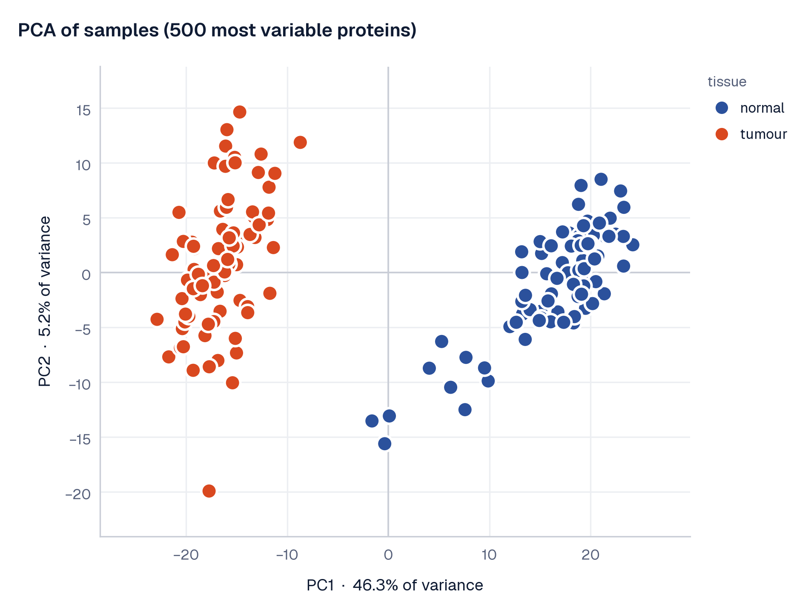 **QC7.** PCA of the 500 most variable proteins: tumour and normal separate on PC1. | 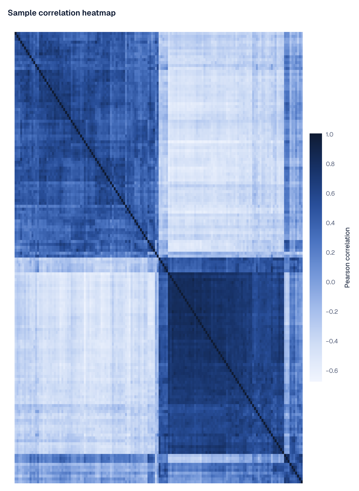 **QC5.** Sample correlations: two blocks, tumour and normal. |
| 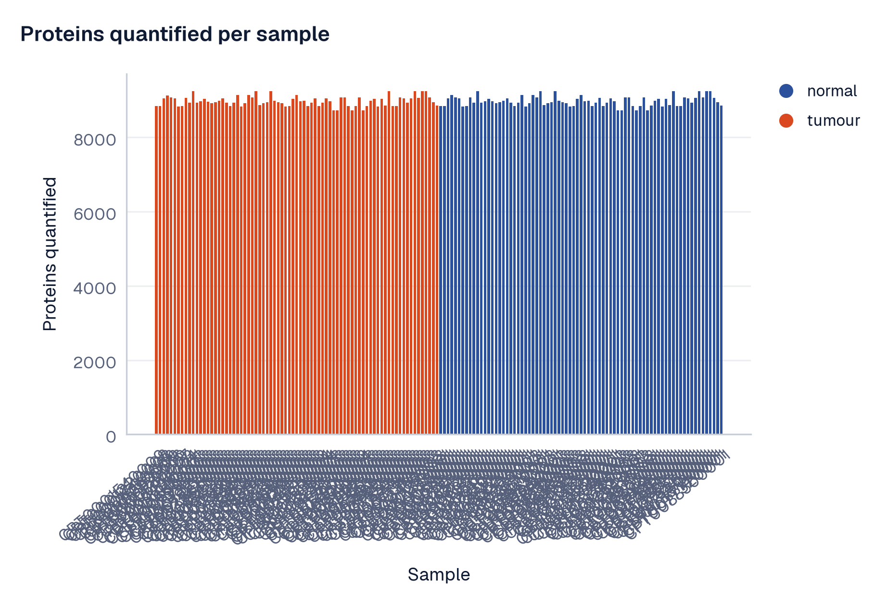 **QC1.** Proteins quantified per sample. | 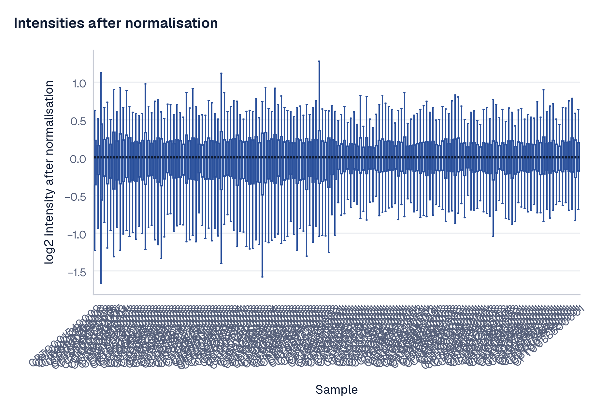 **QC6.** Values after median normalisation. |

The intensity distributions (QC2), protein coverage (QC3), missing values vs intensity (QC4) and the PC associations (QC8) are in [`figures/`](figures).

---

## Figures

| | |
|---|---|
| 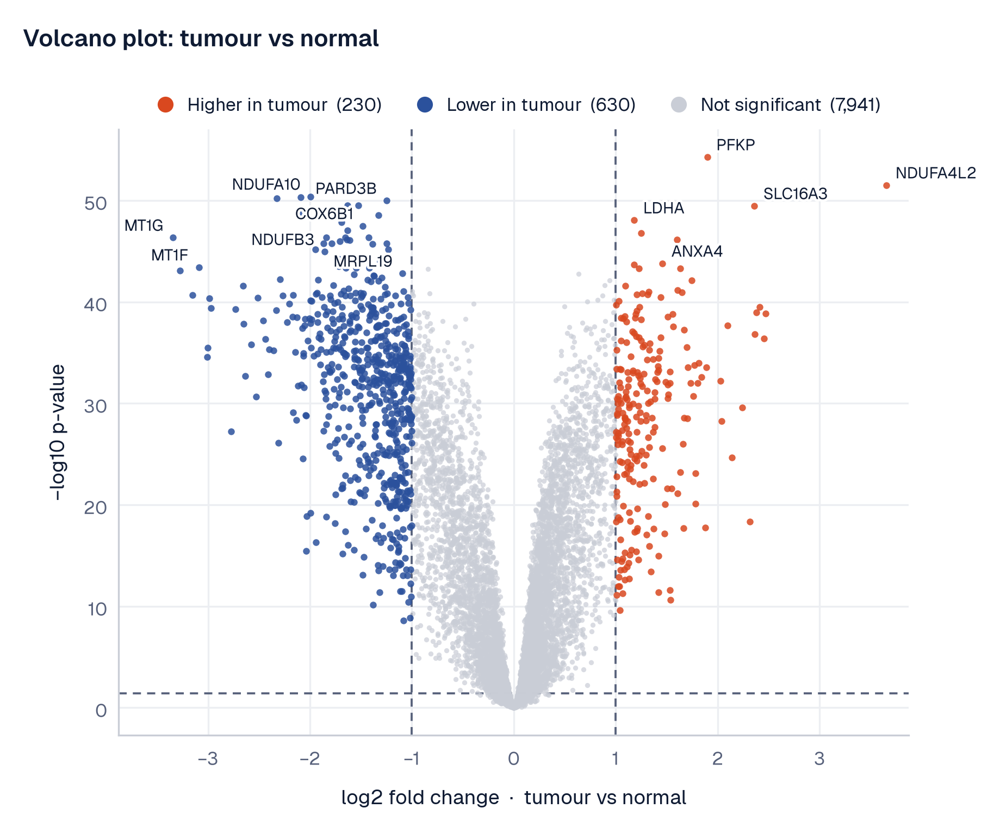 **Figure 1.** Volcano plot: 230 proteins higher and 630 lower in the tumour. | 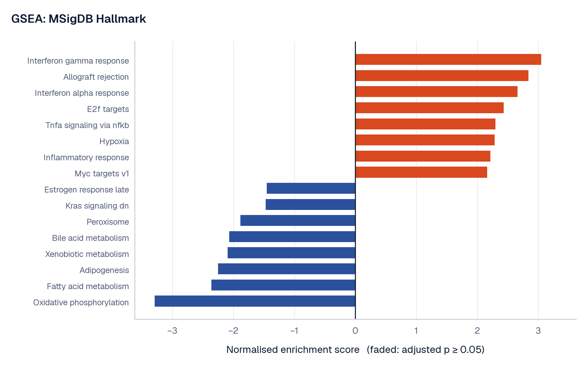 **Figure 4.** Hallmark pathways: oxidative phosphorylation down; interferon, hypoxia and glycolysis up. |
| 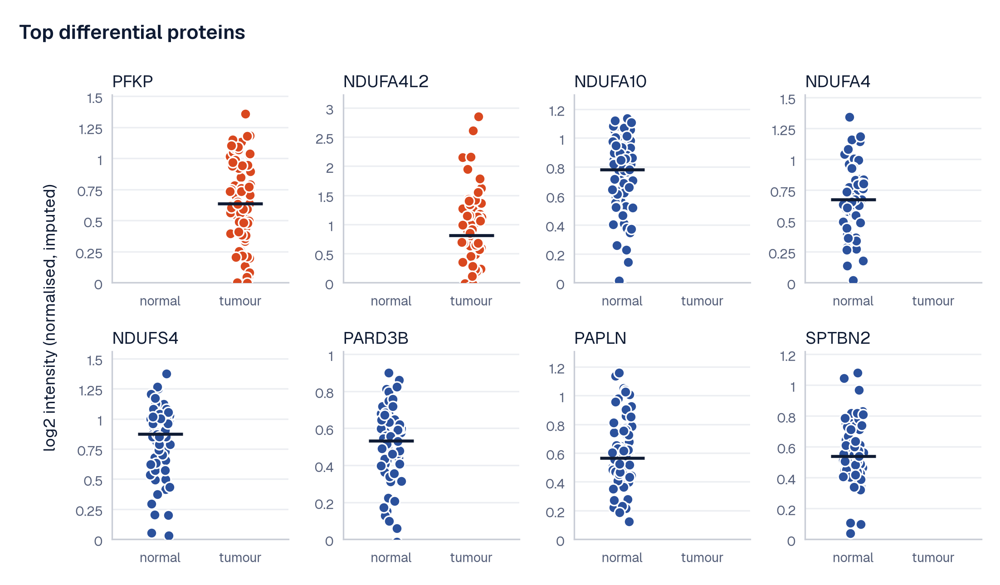 **Figure 2.** The most significant proteins, tumour vs normal. | 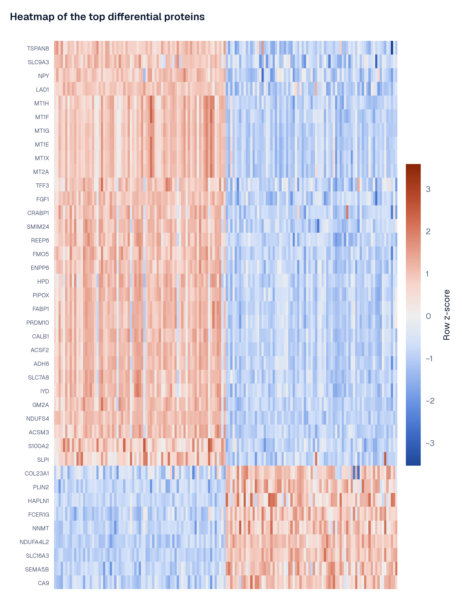 **Figure 3.** The 50 most changed proteins across all samples. |

All figures are in [`figures/`](figures), as PNG (300 dpi) and vector PDF:

| File | What it shows |
|---|---|
| 01 | Volcano plot |
| 02 | Top proteins |
| 03 | Heatmap of changed proteins |
| 04 | Hallmark pathway enrichment (GSEA) |
| 05 | Cell compartments of the changed proteins (GO, over-representation) |
| 06 | Enrichment curves of the leading pathways |
| qc-pca-* | Quality control and PCA |

## The full report

The lab's own report covers every stage: what was done, why, the checks, the results and their limits. It's available as a [**PDF**](report/LSMA-Analysis-Lab-report-kidney-cancer-proteomics.pdf) or as [**HTML**](report/LSMA-Analysis-Lab-report-kidney-cancer-proteomics.html) (download it and open it in a browser for the interactive version).

## Summary tables ([`results/`](results))

| File | Contents |
|---|---|
| `top100_proteins_higher_in_tumour.tsv` | The 100 most significant proteins higher in the tumour, with fold change and adjusted p-value |
| `top100_proteins_lower_in_tumour.tsv` | The same for proteins lower in the tumour |
| `gsea_hallmark.tsv` | Hallmark pathway enrichment: normalised enrichment score and adjusted p-value |
| `sample_qc.tsv` | Quality metrics for every sample |

---

## Workflow

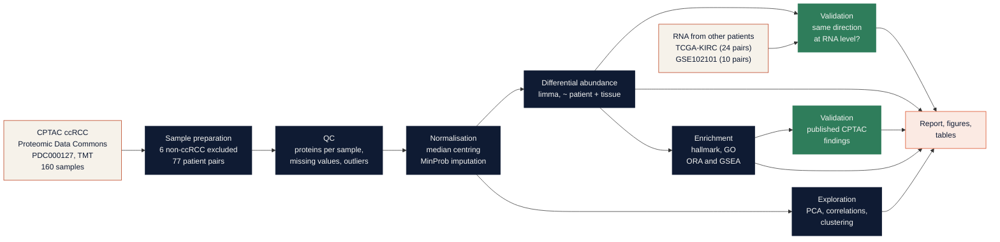

## How it was done

Every step below is a stage in the LSMA Analysis Lab, run with the settings in [`settings/analysis-settings.json`](settings/analysis-settings.json).

1. **Data import.** The study was found in the lab's public data search and imported from the Proteomic Data Commons: the gene-level protein table (log2 ratios to the pooled reference) and the sample sheet for 160 samples.
2. **Sample preparation.** The groups were set to tumour vs normal, with normal as the reference. Six tumours that are not clear cell carcinoma were excluded, with the reason recorded. Samples were paired by patient.
3. **QC.** Proteins quantified per sample, missing values, intensity distributions, sample correlations and an outlier check (3 median absolute deviations). Proteins were kept if quantified in at least 66% of the samples of one group.
4. **Normalisation.** Median centring; missing values imputed from a low-intensity distribution (MinProb, 1st percentile).
5. **Exploration.** PCA and clustering of the 500 most variable proteins, and the association of each component with the sample details.
6. **Differential abundance.** limma with the patient in the model (`~ patient + tissue`), so each tumour is compared with its own normal kidney. Significant: adjusted p < 0.05 (Benjamini–Hochberg) and |log2 fold change| > 1.
7. **Enrichment.** Over-representation and pre-ranked GSEA on the MSigDB hallmark, GO biological process and GO cellular component collections (gene sets of 10 to 500 proteins).

**Software:** R 4.5.2 and Bioconductor 3.21, with limma, imputeLCMD, clusterProfiler, fgsea and msigdbr, in the versions listed in the settings file.

## The mathematics behind the methods

The standard forms of the methods used above, as the lab's code applies them. Protein $g$, sample $j$; all values are log2 ratios to the pooled reference.

**Median centring.**

$$
y'_{gj} = y_{gj} - m_j + \bar m, \qquad m_j = \mathrm{median}_{g}   y_{gj}, \qquad \bar m = \frac{1}{n} \sum_{k=1}^{n} m_k
$$

Each of the $n$ samples is shifted so that its median equals the mean of all sample medians. On the log scale this removes differences in overall loading between samples.

**MinProb imputation.**

$$
y'_{gj} \sim \mathcal{N}\left( q_j, \sigma^2 \right) \quad \text{for each missing value}, \qquad q_j = \text{the 1st percentile of sample } j
$$

A missing value is taken to mean "too low to measure", so it is drawn at random from a narrow normal distribution at the low end of that sample. imputeLCMD sets $\sigma$ from the proteins' typical standard deviation (`tune.sigma = 1`). This filled in 2% of the kept values.

**Linear model with the paired design (`~ patient + tissue`).**

$$
y'_{gj} = \beta_{g0} + \gamma_{g,p(j)} + \beta_{g1} x_j + \varepsilon_{gj}, \qquad \varepsilon_{gj} \sim \mathcal{N}(0, \sigma_g^2)
$$

$x_j$ is 1 for a tumour and 0 for normal kidney, and $\gamma_{g,p(j)}$ is the effect of the patient $p(j)$. So $\beta_{g1}$ is the log2 fold change of tumour over normal within the same patient. (The code fits one mean per tissue plus the patient terms and takes the contrast tumour − normal, which gives the same estimate.)

**limma moderated t-statistic, with an intensity trend.**

$$
\tilde t_g = \frac{\hat\beta_{g1}}{\tilde s_g \sqrt{v_g}}, \qquad \tilde s_g^2 = \frac{d_0 s_0^2 + d_g s_g^2}{d_0 + d_g}
$$

$s_g^2$ is the protein's residual variance on $d_g$ degrees of freedom, and $v_g$ the unscaled variance of the contrast from the design. Empirical Bayes estimates a prior variance $s_0^2$ on $d_0$ degrees of freedom from all proteins; with `trend = TRUE`, $s_0^2$ follows the protein's average intensity. $\tilde t_g$ is compared with a t distribution on $d_0 + d_g$ degrees of freedom, and is also the score used to rank proteins for GSEA.

**Benjamini–Hochberg adjustment.**

$$
p^{\text{adj}}_{(k)} = \min_{l \ge k}   \min\left( 1, \frac{m   p_{(l)}}{l} \right)
$$

$p_{(1)} \le \dots \le p_{(m)}$ are the sorted p-values of the $m$ proteins tested. Calling proteins at adjusted p < 0.05 keeps the expected share of false discoveries at 5%. The same adjustment is applied across gene sets in the enrichment.

**Over-representation analysis (hypergeometric test).**

$$
P(X \ge k) = \sum_{x=k}^{\min(n, M)} \frac{\binom{M}{x} \binom{N-M}{n-x}}{\binom{N}{n}}
$$

$N$ is the number of background genes (all tested proteins) found in the collection, $M$ of them belong to the gene set, $n$ is the number in the list, and $k$ the number in both. Proteins higher and lower in the tumour (adjusted p < 0.05, |log2 fold change| ≥ 1) are tested as separate lists.

**Gene set enrichment analysis (fgsea).**

$$
P_{\text{hit}}(k) = \sum_{g_j \in S,\ j \le k} \frac{\lvert r_j \rvert}{N_R}, \qquad P_{\text{miss}}(k) = \sum_{g_j \notin S,\ j \le k} \frac{1}{N - N_S}, \qquad N_R = \sum_{g_j \in S} \lvert r_j \rvert
$$

All $N$ tested proteins are sorted by the moderated t-statistic $r_j$, and $S$ is a gene set of $N_S$ genes. Walking down the list, the enrichment score ES is the value of $P_{\text{hit}}(k) - P_{\text{miss}}(k)$ furthest from zero. NES divides ES by the mean score of random sets of the same size and the same sign; p-values come from fgsea's multilevel permutation method.

**Spearman correlation (validation).**

$$
\rho = \mathrm{corr}\left( \mathrm{rank}(x), \mathrm{rank}(y) \right)
$$

The correlation of the ranks of the protein fold changes $x$ and the RNA fold changes $y$ of the same genes. It measures agreement in order, without assuming a straight-line relation.

---

## Validation

### 1. Protein changes against RNA from other patients
The 860 changed proteins were compared with the RNA fold changes of the same genes in two independent kidney cancer cohorts, both analysed in the LSMA Analysis Lab in the [bulk RNA-seq repository](https://github.com/MultiOmics-Intelligence/lsma-lab-bulk-rnaseq-kidney-cancer-tcga-kirc). Different patients, different hospitals, a different molecule and a different technology.

| RNA cohort | Changed proteins with RNA data | Same direction | Also significant at RNA level | Correlation, all genes |
|---|---|---|---|---|
| **TCGA-KIRC** (24 pairs) | 810 | **92.8%** (95% of the higher proteins, 92% of the lower) | 680 | Spearman ρ = 0.66 (8,398 genes) |
| **GSE102101** (10 pairs) | 827 | **94.4%** (92% higher, 95% lower) | 694 | Spearman ρ = 0.70 (8,492 genes) |

- **The agreement is strong but not perfect**, as expected: protein levels also depend on translation and protein breakdown.
- **Where they disagree is informative.** *KNG1* (kininogen) is one of the most strongly decreased RNAs in the tumour, but its protein barely changes. KNG1 is a blood protein, so the protein in the tissue may largely come from the circulation.

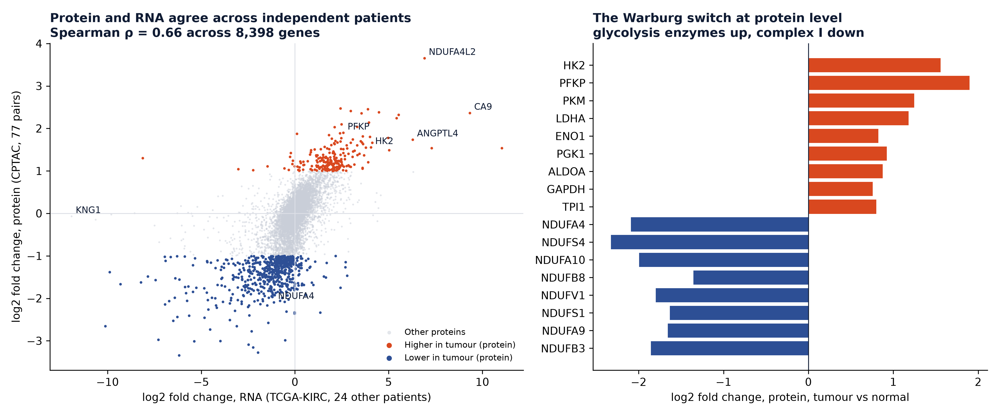

**Figure V1.**
- **Left:** protein fold change (CPTAC) against RNA fold change (TCGA-KIRC) for every gene; the changed proteins are coloured.
- **Right:** glycolysis enzymes are higher and complex I proteins lower in the tumour: the Warburg switch.

### 2. The published CPTAC findings
The original study of this cohort (Clark et al., *Cell* 2019) reported:
- a strong loss of **oxidative phosphorylation** proteins and a gain of **glycolysis** proteins in the tumours: found here (NES −3.29 and +1.76);
- higher **hypoxia** proteins, including CA9: found here (+2.36);
- an **immune-rich** tumour proteome: found here (interferon-γ response, the strongest increased pathway).

**Verdict: replicated.** Tables: [`validation/protein_vs_rna_agreement.tsv`](validation/protein_vs_rna_agreement.tsv) and, for every gene, [`validation/protein_and_rna_fold_changes.tsv.gz`](validation/protein_and_rna_fold_changes.tsv.gz).

---

## Limitations

- **Ratios, not absolute amounts.** TMT values are relative to a pooled reference. They show which proteins change, not how much of each protein is present.
- **Ratio compression.** TMT is known to shrink fold changes, so the true changes are probably larger than reported.
- **Normal kidney is not one tissue.** Normal samples may include cortex, medulla or a little tumour, which may explain the normal samples that sit part-way on the PCA.
- **A second proteomics cohort could not be used.** CPTAC's confirmatory ccRCC study (PDC000411) uses label-free (DIA) measurement. The lab currently imports only TMT ratio tables from the PDC, so that study could not be imported for an independent protein-level replication. RNA from other patients was used instead.
- **Proteins, not activity.** Phosphorylation and other modifications, which control much of protein activity, are not analysed here.
- **A teaching example, not clinical advice.** These results are for education and must not be used to diagnose or treat anyone.

---

## Repository structure

```
lsma-lab-proteomics-kidney-cancer-cptac/
├── README.md                  this case study
├── LICENSE                    CC BY 4.0
├── assets/
│   └── lsma-lab-kidney-proteome-banner.svg     animated banner
├── report/                    the LSMA Analysis Lab's full report
│   ├── LSMA-Analysis-Lab-report-kidney-cancer-proteomics.pdf
│   └── LSMA-Analysis-Lab-report-kidney-cancer-proteomics.html
├── figures/                   key figures, PNG (300 dpi) and vector PDF
│   ├── 01-volcano ... 06-gsea_curves
│   └── qc-pca-*                                quality control and PCA
├── results/                   summary tables (tab-separated)
│   ├── top100_proteins_higher_in_tumour.tsv
│   ├── top100_proteins_lower_in_tumour.tsv
│   ├── gsea_hallmark.tsv
│   └── sample_qc.tsv
├── validation/                protein vs RNA in independent patients
│   ├── validation-protein-vs-rna-and-metabolism.png / .pdf
│   ├── protein_vs_rna_agreement.tsv
│   └── protein_and_rna_fold_changes.tsv.gz
└── settings/
    └── analysis-settings.json          every parameter and software version
```

## Why we share this analysis

This is one of a series of worked examples from the **LSMA Analysis Lab**, published openly for five reasons:

- **To show what the lab does, on real data.** Each repository takes one public dataset through one lab module, from import to report, and shows every step, figure and setting. Nothing is hidden or polished after the fact: the report here is the one the lab produced.
- **To teach a complete analysis, not just a result.** Students see the parts that are usually skipped: quality control, the choice of statistics, an independent validation, and an honest list of limitations.
- **To earn trust by checking known biology first.** These analyses deliberately reproduce findings that are already well established, such as the hypoxia programme and the Warburg switch in kidney cancer. A method that gets the known answers right can be trusted with new questions.
- **To keep testing our own tools.** Every example is a real-world test of the lab. Running public data from start to finish shows what works and what needs fixing, and the fixes go back into the lab for every student. Improvements from this series so far: a more reliable import from NCBI GEO, automatic choice of the right cell-type markers for each tissue in single-cell analysis, and removal of sex-chromosome probes and a more robust DIABLO model in multi-omics.
- **To make the work open and repeatable.** The data are public, every parameter and software version is listed, and diploma students can repeat the same analysis in the lab themselves.

The series follows one cancer, clear cell kidney cancer, through every layer: genes, single cells, DNA methylation, enhancers, mutations, proteins, metabolites and lipids, all of them together in the [multi-omics analysis](https://github.com/MultiOmics-Intelligence/lsma-lab-multi-omics-kidney-cancer-tcga-kirc), and predictions from tumour RNA in the [machine learning analysis](https://github.com/MultiOmics-Intelligence/lsma-lab-machine-learning-kidney-cancer-tcga-kirc). Each repository links to the others. A second cancer, lung adenocarcinoma, is followed through all of these layers in one [full project](https://github.com/MultiOmics-Intelligence/lsma-lab-full-project-lung-adenocarcinoma).

These examples are for education and must not be used for medical decisions.

## Data source and credits

- **Data:**
  - Clinical Proteomic Tumor Analysis Consortium (CPTAC), *CPTAC CCRCC Discovery Study – Proteome* (PDC000127), from the [Proteomic Data Commons](https://pdc.cancer.gov/pdc/study/PDC000127), under the PDC data use terms.
  - RNA for validation: TCGA-KIRC from the [NCI Genomic Data Commons](https://portal.gdc.cancer.gov/projects/TCGA-KIRC) and GSE102101 from [NCBI GEO](https://www.ncbi.nlm.nih.gov/geo/query/acc.cgi?acc=GSE102101).
  - No raw data are copied into this repository.
- **Reference study:** Clark DJ, Dhanasekaran SM, Petralia F, et al. Integrated proteogenomic characterization of clear cell renal cell carcinoma. *Cell* 2019;179:964–983.
- **Methods:**
  - Ritchie et al., *Nucleic Acids Research* 2015 (limma)
  - Korotkevich et al., *bioRxiv* 2016 (fgsea)
  - Liberzon et al., *Cell Systems* 2015 (MSigDB hallmark gene sets)
- **Companion analyses** (same cancer):
  - [bulk RNA-seq](https://github.com/MultiOmics-Intelligence/lsma-lab-bulk-rnaseq-kidney-cancer-tcga-kirc)
  - [single-cell RNA-seq](https://github.com/MultiOmics-Intelligence/lsma-lab-single-cell-kidney-cancer-ccrcc)
  - [DNA methylation](https://github.com/MultiOmics-Intelligence/lsma-lab-dna-methylation-kidney-cancer-tcga-kirc)
  - [active enhancers](https://github.com/MultiOmics-Intelligence/lsma-lab-chip-seq-kidney-cancer-enhancers)
  - [somatic mutations](https://github.com/MultiOmics-Intelligence/lsma-lab-somatic-mutations-kidney-cancer-tcga-kirc)
  - [metabolomics](https://github.com/MultiOmics-Intelligence/lsma-lab-metabolomics-kidney-cancer)
  - [lipidomics](https://github.com/MultiOmics-Intelligence/lsma-lab-lipidomics-kidney-cancer)
  - [multi-omics](https://github.com/MultiOmics-Intelligence/lsma-lab-multi-omics-kidney-cancer-tcga-kirc)
  - [machine learning](https://github.com/MultiOmics-Intelligence/lsma-lab-machine-learning-kidney-cancer-tcga-kirc)

## Run it yourself

Diploma students of the London School of Multiomics & AI can repeat this analysis in the **LSMA Analysis Lab**:
1. **Public data** → Proteomic Data Commons → *PDC000127* (CPTAC ccRCC Discovery, proteome).
2. In sample preparation, set the groups to tumour vs normal, pair by patient and exclude the non-clear-cell tumours.
3. Run **Proteomics** with the comparison on `tissue`.

Find out more about the diplomas at [lsma.co.uk](https://lsma.co.uk).

## Licence

The text, figures and tables in this repository are shared under [Creative Commons Attribution 4.0 (CC BY 4.0)](https://creativecommons.org/licenses/by/4.0/): you may reuse them with credit to the London School of Multiomics & AI. CPTAC, TCGA and GEO data remain under their own terms.

---

**Dr. Anas Alzaeem**, Academic Director, London School of Multiomics & AI


